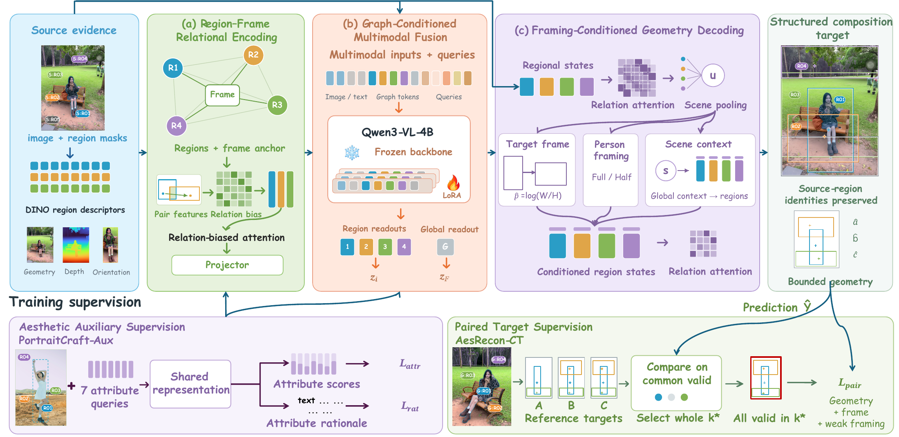
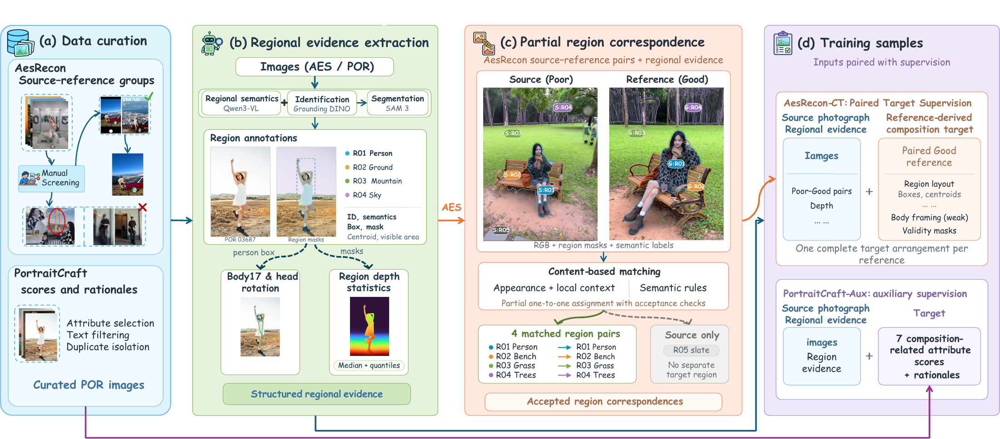

# NextShot

**Learning Source-Grounded Structured Composition Targets for Portrait Photography**

[中文说明](README_zh-CN.md) · [Method and code](docs/METHOD.md) · [Paper results](docs/RESULTS.md) · [Data construction](docs/DATA.md) · [Release scope](docs/RELEASE.md)

NextShot predicts a desired composition for a portrait photograph while preserving the identities of its observed people and scene regions. Given an image and prepared regional evidence, it jointly predicts region boxes, visible centroids and areas, target frame aspect ratio, and coarse full-body / half-body framing.

This repository contains the core 4B model, supervision losses, selected region-matching algorithms, and figures and results from the paper. It is a **partial research code release**; trained weights, training orchestration, and an image-to-prediction application are not included.

## Method



*Paper Figure 3. Source regions and a frame anchor are encoded with relational attention. Qwen3-VL integrates graph tokens with image and textual observations. Predicted frame and person framing condition the final regional geometry.*

- **Source-grounded supervision:** partial correspondence transfers reference geometry to source-region identities; each reference remains one complete alternative arrangement.
- **Relational multimodal prediction:** region–region and region–frame attention biases combine with a frozen Qwen3-VL-4B backbone and trainable language-layer query/value LoRA adapters.
- **Framing-conditioned decoding:** the model predicts the frame and coarse person framing before conditioning boxes, centroids, and visible areas on those predictions.
- **Auxiliary aesthetic learning:** PortraitCraft attribute scores and rationales train shared representations. Auxiliary heads are removed for layout inference.

## Selected paper results

| Evidence | Reported result | Evaluation scope |
| --- | --- | --- |
| Regional geometry | Box IoU **0.6373**, compared with **0.5639** for NoChange | 781 sources with eligible reference geometry |
| Layout preference over AR-8B | **79.5% / 81.0%** under Qwen / Flash | 200 fixed test sources; model-based judgments |
| Guided photography | **78.0%** preference for guided recaptures | 390 of 500 human judgments, 100 photograph pairs, 5 evaluators |

These are results reported in the supplied manuscript, not results regenerated by this release. [The full tables](docs/RESULTS.md) include ablations, denominators, and measured-resource boundaries. NextShot does not lead every individual reference-agreement metric.

## Supervision construction



*Paper Figure 2. AesRecon-CT supplies paired geometric targets; PortraitCraft-Aux supplies composition-related attribute scores and rationales.*

The released matching module accepts region descriptions and **precomputed appearance/context similarity matrices**. It implements semantic compatibility, partial one-to-one assignment, rejection thresholds, and ambiguity checks. It does not extract pretrained features or reconstruct the full dataset. See [data construction and membership](docs/DATA.md).

## Code map

| Paper component | Implementation |
| --- | --- |
| Region–frame relational encoder, multimodal backbone, LoRA | [nextshot/backbone.py](nextshot/backbone.py) |
| Framing-conditioned regional geometry | [nextshot/decoder.py](nextshot/decoder.py), [nextshot/framing.py](nextshot/framing.py) |
| Main model and auxiliary attribute/rationale branch | [nextshot/model.py](nextshot/model.py) |
| Complete-reference supervision | [nextshot/geometry_loss.py](nextshot/geometry_loss.py), [nextshot/losses.py](nextshot/losses.py) |
| Source-only and auxiliary batch construction | [nextshot/source.py](nextshot/source.py), [nextshot/auxiliary.py](nextshot/auxiliary.py) |
| Partial region matching | [data_processing/matching.py](data_processing/matching.py), [data_processing/semantics.py](data_processing/semantics.py) |
| Regional crop and padding utilities | [data_processing/regions.py](data_processing/regions.py) |

[Method notes](docs/METHOD.md) explain the equations, preserved constructor chain, and code correspondence. [MODEL_IO.md](docs/MODEL_IO.md) specifies the prepared inputs and outputs.

## Installation and core checks

Use Python 3.10 or newer for the packaged environment. The CPU checks need PyTorch, NumPy, SciPy, and Pillow, but do not load Transformers or download model weights.

```bash
python -m pip install -r requirements.txt
python -m unittest discover -s tests -v
```

Optional editable installation:

```bash
python -m pip install -e .
```

The supplied [architecture configuration](configs/nextshot_4b.json) makes the synthetic checks self-contained. It is not a complete training recipe. Instantiating the pretrained model additionally requires the backbone dependencies, a separately obtained Qwen3-VL-4B-Instruct directory, and prepared regional inputs. A trained NextShot adapter is also required for meaningful trained predictions. See [environment and verification](docs/VERIFICATION.md).

## Scope and interpretation

- Model input includes prepared regions and features, not RGB alone.
- Output is a target composition specification, not a crop transform, generated photograph, or camera-motion estimate.
- Person framing is coarse full/half-body; fine body-part visibility outputs remain unknown.
- Original photographs, dataset inventories, pretrained weights, training checkpoints, training/evaluation launchers, and interactive examples are outside this release.
- The supplied manuscript is an anonymous submission marked under review at ICLR 2027. No acceptance claim is made here.

## Attribution and rights

Paper title and source information are recorded in [release notes](docs/RELEASE.md). The author list and permanent publication identifier are not supplied in the anonymous manuscript, so no author citation has been invented. [Third-party acknowledgments](THIRD_PARTY_NOTICES.md) identify the datasets, models, and libraries used in the research. No open-source license has been selected for this package; see [rights status](RIGHTS.md).
